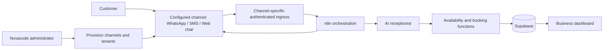

# Architecture — conceptual overview

This diagram describes the **intended integration**, not a verified production deployment.

## Boundaries
1. **Supabase**: tenant data, authentication, authorization, availability and booking functions.
2. **n8n**: workflow orchestration and channel routing; hosting permanence remains to be verified.
3. **Evolution API**: WhatsApp integration under test; production session health and isolation must be verified.
4. **Twilio**: SMS integration; campaign approval was reported, but sender association, webhook and delivery tests still need verification.
5. **Business dashboard**: business-scoped appointment, service and customer management; deployment target not yet verified.
6. **Super Admin**: aggregate counts and incidents, without exposing routine customer records.

## Security requirements
- Resolve the tenant from authenticated channel configuration; never trust a business ID supplied in a customer message.
- Verify Twilio webhook signatures and protect other channel ingress.
- Enforce Supabase RLS and least-privilege credentials.
- Use idempotency keys (e.g. provider message IDs) to avoid duplicate message processing or bookings.
- Verify customer identity for reading/cancelling existing appointments.
- Do not confirm a booking unless the backend returns success.
- Avoid leaking customer content into monitoring logs.
